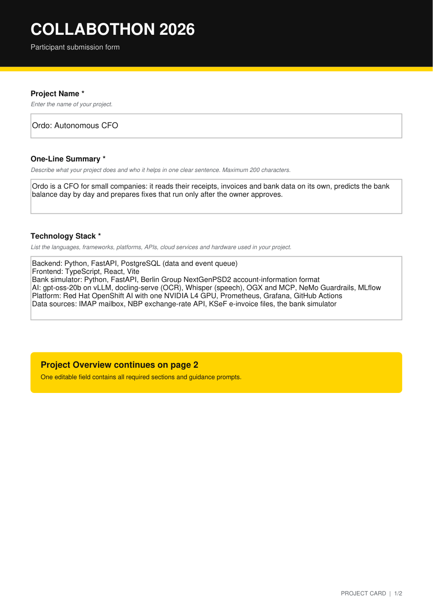
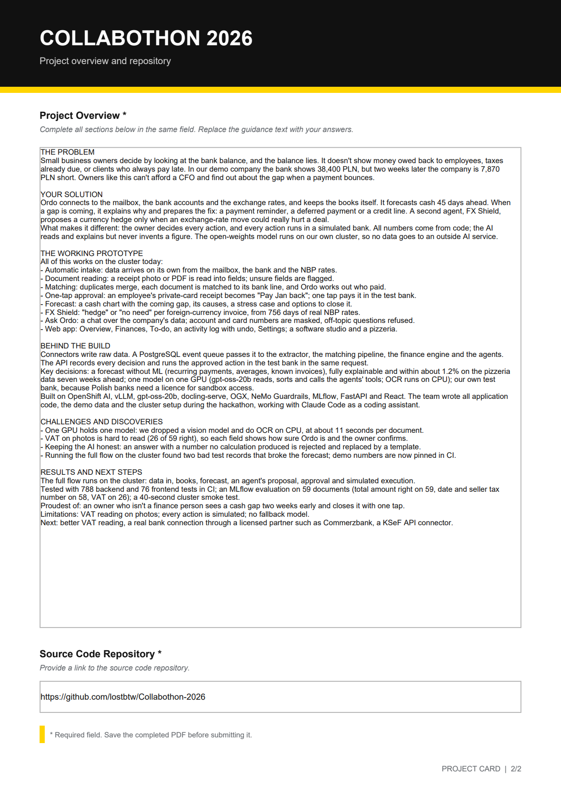

# Ordo: Autonomous CFO

Collabothon 2026 · Commerzbank × Red Hat · **[Project card (PDF)](docs/project-card/Ordo_Project_Card.pdf)**

[](docs/project-card/Ordo_Project_Card.pdf)

[](docs/project-card/Ordo_Project_Card.pdf)

Ordo reads a small company's receipts, invoices and bank data, records them in its books, predicts the bank balance for the next 45 days and suggests what to do when it is about to run short. Nothing that moves money runs until the owner approves, and every action goes to a simulated bank. All data in this repository is synthetic.

## How it works

1. Ordo picks up new data on its own: e-mails with invoices, bank transactions, daily exchange rates and e-invoices from the Polish KSeF system.
2. Receipts and invoices are read into fields (seller, date, amounts, VAT). Each one is matched to its bank payment, and Ordo works out whether the company or an employee paid.
3. The finance engine records everything in the books and predicts the bank balance for each of the next 45 days, including taxes that will fall due.
4. When something needs attention, an agent prepares a proposal: pay an employee back, set money aside for a tax, ask a client to pay sooner, open a credit line, or fix an exchange rate.
5. The owner approves or rejects it in the web app. Approved actions go to the bank simulator; nothing touches a real bank.

The language model (gpt-oss-20b, running on Red Hat OpenShift AI) only reads documents and explains; every amount is calculated by code.

## Repository

| Folder | What is in it |
|---|---|
| `backend/connectors` | Pull data from the mailbox, the bank (PSD2-style API) and the NBP exchange rates |
| `backend/queue` | The event queue on PostgreSQL: delivery, retries, ordering |
| `backend/pipeline` | Turn raw items into documents: OCR and the model (`extract/`), duplicates, matching to bank payments, who paid |
| `backend/finance` | Ledger, 45-day forecast, Polish tax rules (VAT, CIT, PIT-4, ZUS), FX exposure |
| `backend/agents` | Liquidity, FX Shield, tax, receivables and chat agents that create proposals for the owner |
| `backend/api` | REST API for the web app; records approvals and sends approved actions to the bank |
| `backend/executor` | Runs an approved action against the bank simulator |
| `backend/db` | Database migrations and seed data |
| `frontend` | The web app: Overview, Finances, To-do, Activity, Settings, chat |
| `sim/bank` | The bank simulator: PSD2-style accounts and transactions, plus simulated credit lines, FX forwards and payment drafts |
| `sim/scenario`, `sim/documents` | Generators of the synthetic demo company: bank statements, KSeF invoices, receipts |
| `sim/releaser` | Sends the demo data into the app over time, as it would arrive in real life |
| `contracts` | JSON schemas, the OpenAPI spec and sample data every part is built against |
| `deploy` | Everything to run on Red Hat OpenShift AI: model serving, app, guardrails, monitoring |
| `notebooks` | Extraction evaluation notebook (runs on OpenShift AI) |

## Run it locally

You need Python 3.12 with [uv](https://docs.astral.sh/uv/) and Node.js.

**Web app only, on sample data** (no backend needed):

```bash
cd frontend
npm ci
npm run dev            # http://localhost:5173
```

**Web app with the real API and demo data** (no Docker; a local PostgreSQL starts on its own):

```bash
uv sync --group localdb
PORT=8000 uv run python -m backend.api.dev       # API on http://localhost:8000/api/v1

cd frontend
VITE_API_MODE=live npm run dev                   # http://localhost:5173, uses the API above
```

If your `.env` sets `ORDO_DATABASE_URL`, the API connects to that database instead of starting its own; remove the line to use the built-in one. On Windows PowerShell set the variables like this: `$env:PORT=8000`, `$env:VITE_API_MODE="live"`.

**Bank simulator on its own:**

```bash
cd sim/bank
pip install -r requirements-dev.txt
BANK_TOKEN=demo-token uvicorn bank_sim.app:app --port 8081
```

## Tests

```bash
uv run python -m pytest                    # backend
python contracts/validate_fixtures.py      # sample data matches the schemas
cd frontend && npm test                    # web app
```

On every pull request CI checks the sample data, runs the backend tests and type-checks the web app.

## Deploy on OpenShift AI

Everything runs in one OpenShift project. With `oc` logged in to the cluster:

```bash
deploy/platform/setup.sh secrets           # create the Secrets (names in deploy/secrets.example.yaml)
deploy/platform/setup.sh apply             # model, database and app resources
deploy/platform/setup.sh redeploy          # build the images from main and roll them out
deploy/platform/setup.sh smoke             # check the whole deployment in about 40 seconds
```

After that, every merge to `main` rebuilds and rolls out the app on its own.
