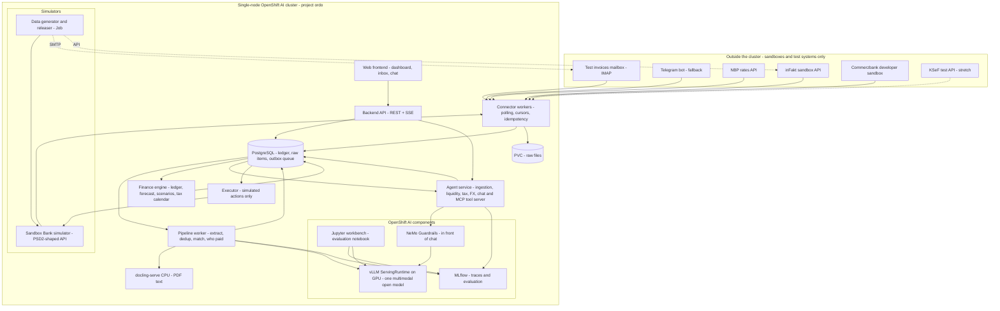

# 01 — Solution

Self-contained. Working product name: **Ordo** (rename freely).
Claim labels: `VERIFIED (source)` / `UNVERIFIED (reason)`.

---

## 1. Problem

Owners of small companies run finance themselves. They look at the bank balance and decide. The balance is misleading because it does not show:

| Hidden from the bank balance | Example in the demo company |
|---|---|
| Money owed to employees who paid company costs privately | 5,169 PLN across 10 receipts |
| Taxes and social security already incurred but not yet due | VAT 14,300 on the 25th; ZUS 9,400; tax advances 10,900 |
| Client invoices that will arrive late | 18,400 EUR from a client who pays 23 days late on average |
| Costs paid from the owner's private card | 15 purchases in 2026 |
| Duplicates, missing documents, wrong currency | 61 duplicate documents, 20 payments without a document |

Result: the bank says **38,400 PLN**; the truth is **−7,870 PLN in two weeks**, and **−28,170 PLN** if one client slips again.

## 2. Target user

**Tomasz, 41, owner of a 7-person software studio in Łódź.** Sells to clients in Poland and Germany. Has an external accountant who books last month; has nobody who looks at next month. Team members buy tools with their own cards because they have no access to the company account. He is good with apps, impatient with finance words.

Second persona, same product: **Vincenzo, 58, pizzeria owner** (the organisers' scenario). One account, no documents problem, low patience for software. He needs the one-glance answer and a single sentence to type.

Not the user: the accountant (keeps their role), employees (they only forward documents), a finance team.

## 3. The product in one paragraph

Ordo connects to the places a small company's money information lives — a shared invoices mailbox, bank accounts, the invoicing tool, the national e-invoice system, exchange rates — and keeps pulling from them on its own. An ingestion agent reads every document, removes duplicates, matches documents to payments, works out who really paid, and turns the result into one ledger that the owner approves. A deterministic finance engine forecasts cash day by day from that ledger. A liquidity agent watches the forecast, and when a gap is coming it explains why in plain language, tests the options, and prepares the cheapest sufficient action — up to a credit-line application — which runs only after the owner approves, and in this build only against a simulator. An embedded chat answers questions with links to the underlying rows and lets the owner tell the system about the future ("we are closed in June").

## 4. Control model (applied to every agent action)

Two labels on everything the agents produce. Both are required schema fields (`control_level`, `execution_mode`).

| Level | Meaning | Badge | Owner effort |
|---|---|---|---|
| **Analysed autonomously** | The agent did it alone. Read-only work with no effect outside the app. Listed in the "What I did on my own" feed. Undoable | grey | none |
| **Recommendation** | Advice. Nothing to execute | blue | read |
| **Approval required** | An action is prepared. It runs only after the owner approves; the owner can edit it first | amber | one tap |

| Execution mode | Meaning in this build |
|---|---|
| none | Nothing to execute |
| **simulated** | Executed against the sandbox bank / written as a draft. **Every action in the hackathon build.** The word SIMULATED is on the button and in the result |
| permitted | Would execute for real in production. The server refuses this mode in this build |

### 4.1 Action catalogue

| Agent | Action | Control level | Execution |
|---|---|---|---|
| Ingestion | Fetch, store, read documents and bank lines | analysed autonomously | none |
| Ingestion | Merge duplicates; resolve counterparties | analysed autonomously | none |
| Ingestion | Confirm a match with score ≥ 0.90 in a known recurring series | analysed autonomously (undoable) | none |
| Ingestion | Fix a data-quality problem (CHF line, inferred opening balance) | analysed autonomously, shown as a note | none |
| Ingestion | Suggest a category; flag "VAT not deductible", "looks private", "document missing" | recommendation | none |
| Ingestion | Book ledger entries for anything with a tax or reimbursement consequence | approval required | simulated (internal ledger) |
| Ingestion | Reimburse an employee | approval required | simulated (payment draft in the sandbox bank) |
| Liquidity | Build and refresh the forecast; detect gaps; run what-if scenarios | analysed autonomously | none |
| Liquidity | "Send a payment reminder to client X" | approval required | simulated (e-mail draft, not sent) |
| Liquidity | "Delay payment Y by N days" | recommendation | none |
| Liquidity | "Open a credit line of Z" | approval required | simulated (application to the sandbox bank) |
| Tax (partial) | Compute upcoming VAT / ZUS / advance payments from the ledger and the calendar | analysed autonomously | none |
| Tax (partial) | "Set aside N for VAT due on the 25th" | approval required | simulated (transfer to a tax pocket) |
| Tax (partial) | "You lost N of VAT this year on private-name purchases — issue company cards / give the tax number at the till" | recommendation | none |
| FX (partial) | List open foreign-currency exposure with value at today's rate and at ±5% | analysed autonomously | none |
| FX (partial) | "Fix the rate for the 18,400 EUR you expect on 7 Dec" (forward) | approval required | simulated |
| Chat | Answer questions with evidence | analysed autonomously | none |
| Chat | Record an owner statement about the future as a forecast event | owner's own action | none |
| Chat | Anything that moves money | **cannot**; it creates a card in the inbox instead | — |

## 5. Use-case coverage

| Challenge use case | Coverage | What exactly | Why |
|---|---|---|---|
| **Liquidity agent** | **Complete**, end to end | Monitors accounts (connectors) -> forecasts 45 days -> detects gap -> proposes credit facility with explanation and alternatives -> approval -> simulated application -> forecast updates | Best fit with the data we can create and with the organisers' own dataset; clear bank product at the end |
| Tax agent | Partial (extension 1) | Tax calendar and amounts inside the forecast; tax-reserve card; "VAT lost" optimisation hint | Falls out of the ledger almost for free; matches "coordinates advance tax payments and identifies optimisation opportunities" |
| FX hedging agent | Partial (extension 2, nice-to-have) | Exposure list; one simulated forward card (EUR receivable; CHF tranches on the pizzeria) | Small effort, natural with multi-currency data. No rate prediction |
| Investment agent | Not built | One sentence: once the forecast shows durable surplus, the same engine can propose a fixed-term deposit | Does not fit a company that struggles to make payroll |

## 6. Architecture on OpenShift AI

### 6.1 Components

| Component | Tech | Pods | Notes |
|---|---|---|---|
| Frontend | React + Vite + TypeScript, static build on an unprivileged nginx image | 1 | The challenge card suggests TypeScript web apps |
| Backend API | Python 3.12 + FastAPI | 1 | REST per `contracts/openapi.yaml`; SSE stream |
| Connector workers | Python, same image, different entrypoint | 1 | In-process scheduler, one loop per source |
| Pipeline worker | Python, same image | 1 | Consumes the outbox; calls docling-serve and vLLM |
| Finance engine | Python module inside the pipeline worker (or own pod if it lags) | 0–1 | Pure functions; unit-tested against the pizzeria numbers |
| Agent service | Python, `openai` SDK against the vLLM endpoint; own 60-line tool loop; tools also exposed as an MCP server | 1 | No heavy agent framework (D-10) |
| Executor | Python module in the API | 0 | Only talks to the Sandbox Bank |
| Sandbox Bank + generator | Python FastAPI; generator as a Job | 1 + Job | `contracts/bank-sim-api.md` |
| PostgreSQL | Red Hat PostgreSQL image from the developer catalog, one PVC | 1 | Also the queue (D-07) |
| Raw file store | PVC mounted by connectors, pipeline and API | — | No MinIO (one service less) |
| docling-serve (CPU) | `quay.io/docling-project/docling-serve-cpu`, limits 4 CPU / 4 Gi | 1 | Only for PDFs with a text layer. Photos go to the vision model. Image and limits VERIFIED ([repo](https://github.com/docling-project/docling-serve)); CPU speed UNVERIFIED |
| Model serving | RHOAI "vLLM NVIDIA GPU ServingRuntime for KServe", RawDeployment, one model | 1 | Section 6.3 |
| MLflow | RHOAI component (`mlflowoperator: Managed`, `MLflow` CR, dev variant with SQLite + PVC) | 1 | VERIFIED in RHOAI 3.5 docs (Working with MLflow) by the research agent; whether it is pre-enabled on our cluster is UNVERIFIED |
| Jupyter workbench | RHOAI workbench, started only when needed | 0–1 | Stop before the demo |
| NeMo Guardrails | `NemoGuardrails` CR (TrustyAI) | 1 | Should-have bonus |

Why "numbers are code": the LLM never calculates. It reads documents into a JSON schema, chooses among tools, and writes sentences. Every number on screen comes from the finance engine or from an extraction with a confidence value, and the agent service rejects any generated text containing a number that is not present in the tool results it was given (D-02).

### 6.2 Agents

| Agent | Trigger | Tools it can call | Output |
|---|---|---|---|
| Ingestion | `raw_item.received` | parse_xml, extract_document (vision/text model with JSON schema), validate_document, find_duplicates, match_candidates, classify_category | Document, Match, Recommendation (review / reimburse / flag) |
| Liquidity | `forecast.updated` when an alert exists or changes | get_forecast, list_overdue_receivables, run_scenario (credit line, shift receivable, shift payable), get_bank_price_list | One Recommendation with ranked alternatives; the engine re-checks the numbers |
| Tax (partial) | daily + ledger changes | tax_calendar, vat_position, vat_lost_summary | Tax-reserve card; optimisation hint |
| FX (partial) | daily + new foreign-currency invoice | open_exposure, fx_rate, simulate_forward | Exposure note; forward card |
| Chat | owner message | get_cash_position, get_forecast, search_ledger, explain_recommendation, add_forecast_event, run_readonly_sql | Answer + evidence links; optionally a new inbox card |

Agent loop: `messages + tools -> model -> tool calls -> results -> … -> final JSON (schema-constrained) -> validate -> store`. Maximum 6 tool calls. On any failure the agent falls back to a template text built from the same engine numbers, so the card always appears.

Guardrails (should-have): the chat path goes through NeMo Guardrails with (a) PII masking of IBANs, card numbers and tax ids in the text sent to the model, (b) a topic rail that refuses investment advice and anything outside the company's finances, (c) an action rail: chat can never call an execution tool. (c) is also enforced in code.

SQL tool safety: a dedicated database role with `SELECT` on 6 views only, `statement_timeout = 3s`, `LIMIT 200` appended, single statement, rejected if it contains anything but `SELECT`/`WITH`.

### 6.3 Model choice and memory math

The GPU type is **unknown** (UNVERIFIED — check in hour 1). Plan per scenario. All model facts below were verified by the research agent on Hugging Face model cards and the vLLM docs on 2026-11-20; none was run by us.

| GPU found | Model | Weights | Left for context cache | Serve flags |
|---|---|---|---|---|
| 24 GB (L4 / A10G) | `RedHatAI/Qwen3.5-9B-FP8-dynamic` — 9.65B, vision + tools, Apache-2.0 | 14.0 GB | about 8 GB at `--gpu-memory-utilization 0.92` -> 16k context is comfortable | `--max-model-len 16384 --enable-auto-tool-choice --tool-call-parser qwen3_coder` |
| 48 GB (L40S) | `RedHatAI/Qwen3.8-27B-FP8` — 27.8B, vision + tools, Apache-2.0 | 30.9 GB | about 13 GB -> 32k context | `--max-model-len 32768 --enable-auto-tool-choice --tool-call-parser qwen3_xml --reasoning-parser qwen3` |
| 80 GB | Same 27B FP8, more concurrency | 30.9 GB | about 42 GB | same, `--max-num-seqs 16` |
| Fallback if Qwen fails to load | Mistral Small 3.1 24B quantised, already in Red Hat's registry (`registry.redhat.io/rhelai1/modelcar-mistral-small-3-1-24b-instruct-2503-quantized-w4a16:1.5`), vision + tools | about 15 GB (UNVERIFIED estimate for 4-bit) | — | `--tool-call-parser mistral` |

Why one multimodal model and not three: one GPU, one model in memory, no swapping; the same model reads receipts, picks categories from the fixed list, calls tools and writes explanations. Granite 4.2 has no vision, and Polish is not among its tested languages (VERIFIED from the model card by the research agent) — it stays an option if judges value an IBM model, at the cost of a second model for images.

Structured output: vLLM 0.24 (the version in RHOAI 3.5 — VERIFIED, [release notes](https://docs.redhat.com/en/documentation/red_hat_ai_inference/3.5/html-single/release_notes/index)) uses `response_format: {type: "json_schema", …}`; the older `guided_json` parameter was removed (VERIFIED, [vLLM docs](https://docs.vllm.ai/en/latest/features/structured_outputs/)).

Model download: none of the three preferred models is in the pre-built modelcar catalog in FP8, so they come from Hugging Face (`hf://`) — 14–31 GB. UNVERIFIED that the cluster can reach huggingface.co and how long the pull takes. **Start the download in the first 30 minutes.** If Hugging Face is unreachable, use the Mistral modelcar from `registry.redhat.io`.

RAM budget (128 GB node; platform figure is an estimate — UNVERIFIED, read real usage with `oc adm top nodes`):

| Consumer | RAM |
|---|---|
| OpenShift control plane + RHOAI operators | about 30 GB |
| vLLM pod (host RAM) | 24 GB |
| PostgreSQL | 2 GB |
| API, connectors, pipeline, agents, bank simulator, frontend | 5 GB |
| docling-serve CPU | 4 GB |
| MLflow | 2 GB |
| NeMo Guardrails | 2 GB |
| One Jupyter workbench (not during the demo) | 8 GB |
| OGX server (stretch) | 4 GB |
| **Total** | **about 81 GB**, 47 GB headroom |

Every pod gets requests and limits. The model Deployment uses the `Recreate` strategy (a rolling update would need a second GPU).

## 7. Bonus items

Rule from Red Hat: 2–4 items, hard criteria and domain logic first. Before deciding, run `oc get datasciencecluster -o yaml` and see what is already `Managed` — pre-enabled components change the cost.

| Rank | Item | Effort | Cluster risk | Why it fits | Status |
|---|---|---|---|---|---|
| 1 | **vLLM** | 0 h extra (it is the default GPU runtime) | none | Needed anyway | **Must** |
| 2 | **MLflow tracing + evaluation** | 2–4 h | low | Traces of every extraction and agent run are our explainability backbone (`trace_id` on documents and recommendations). Evaluation: receipt-extraction accuracy against `ground_truth.json` — a number for the pitch | **Must** |
| 3 | **Jupyter notebook on OpenShift AI** | 0.5 h | low (8 GB while open) | The evaluation in item 2 is run from a workbench notebook; MLflow is pre-configured there | **Must** (comes with 2) |
| 4 | **NeMo Guardrails** | 2–3 h | low, CPU only | PII masking and an "advice/action" rail in front of the chat: a bank cares | **Should** |
| 5 | OGX + MCP | 3–5 h | medium (Technology Preview, needs its own PostgreSQL) | Our tools are an MCP server from the start, so OGX can be put in front later: the agent service already speaks the OpenAI API, which OGX also exposes | **Stretch** — only if 1–4 are shown to Red Hat by Saturday 18:00 |
| — | OSS coding agent (OpenCode in a workbench, pointed at our model) | 1–2 h | low | Cheap to claim; a 9B model is weak for real coding | Optional, role 1's call |
| — | MaaS gateway, llm-d | 4–8 h each, high risk on one node | high | No benefit with one GPU and one replica | **No**, unless pre-installed |
| — | OpenShell | experimental, needs privileged SCC | high | Sandboxes coding agents, not our app | **No** |
| — | Quarkus + LangChain4j | 3–4 h with a Java-fluent person | low | Team is Python/TypeScript | **No** |
| — | Dev Spaces | separate operator, 4–8 GB per workspace | medium | Laptops are faster | **No** |

OGX is the renamed Llama Stack (VERIFIED by the research agent in the RHOAI 3.5 "Working with OGX" docs; read through a browser because the docs site blocks automated fetching).

## 8. Explainability

| Layer | What the owner sees | Where it comes from |
|---|---|---|
| Sentence | "On 30 November salaries go out before your biggest client has paid." | `recommendation.summary` (LLM wording or template) |
| Reasons | 3 bullets, each with a link | `explanation.why[]` + `evidence[]` |
| Calculation | Label, value, formula with the actual numbers | `explanation.calculation[]` from the finance engine |
| Alternatives | Cheaper options first, with pros, cons, cost | `explanation.alternatives[]` |
| Assumptions and confidence | "If Nordwind pays on 21 Dec instead…" | `explanation.assumptions[]`, `confidence` |
| Evidence | Click -> the bank line, the document image with highlighted fields, the SQL result, the forecast component | `EvidenceLink` (kind + id + url) |
| Who wrote it | "Numbers: finance engine. Wording: <model>." | `explanation.generated_by` |
| Trace | For technical judges: the MLflow trace of the run | `trace_id` |
| Audit | Who approved what, when, with which changes, and the simulated result | `Approval` records |

Forecast explainability: the chart is a stack of named components (`forecast.components[]`): "Salaries, monthly on the last business day, seen 10 times", "Nordwind invoice, expected 7 Dec = due date + 23 days average delay". Clicking a component shows its source rows. There is no opaque model.

## 9. Positioning against existing solutions

Full competitor table with sources: `00_ANALYSIS.md` section 5.6. Summary:

| "This already exists" | True? | Our answer |
|---|---|---|
| Receipt and invoice capture (Saldeo, wFirma, Dext, Payhawk…) | Yes, commodity | We do not sell capture of single documents. We sell the reconciled, owner-approved ledger across every source — and the forecast and bank action it makes possible |
| Reimbursing employees (Pleo, Spendesk, Payhawk, Symfonia) | Yes — if everyone uses the vendor's card | We handle what actually happened: private cards, the wrong buyer on the invoice, duplicates across e-invoice, PDF, photo and bank |
| Cash-flow forecast (Agicap, Qonto, mBank's own 4-week view) | Yes | Those assume clean books or one bank. Ours includes liabilities no bank feed shows, and every figure opens the document, bank line and approval behind it |
| AI agents for SME banking (Qonto, Finom) | Yes, inside their own account | Bank-agnostic on data, bank-native on action: ends in a pre-filled overdraft request (mBank "kredyt w rachunku bieżącym" / Commerzbank "Gewerbekredit") the owner approves |
| An SME-facing agent from Commerzbank | None found | That is the opportunity this challenge describes |

Five lines for the pitch and the Q&A:

1. "Capture tools read documents and forecast tools assume clean books. We build the owner-approved ledger between them, from every messy source."
2. "The bank balance says 38,400. The truth is minus 28,000 in three weeks. The difference is in mailboxes, phones and private cards."
3. "We price the mistake: this receipt without the company tax number cost 243 złoty of VAT — and here is how to stop it."
4. "mBank already shows a 4-week forecast. We make it trustworthy and actionable."
5. "The agent does the reading, the matching and the maths. The owner does the deciding."

Not our claim: replacing the accountant, tax advice, filing, or real execution.

