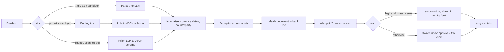

# 02 — Data and live sync

Self-contained. Read this if you own connectors (role 2), document reading and matching (role 3) or the synthetic data (role 6).
Working product name: **Ordo**. Fictional demo company: **Borsuk Labs sp. z o.o. (SAMPLE)**.

Claim labels: `VERIFIED (source)` = checked today, `UNVERIFIED (reason)` = assumption, test before relying on it.

---

## 1. What this layer must prove

1. Data arrives **by itself** from real, running connectors. File upload exists only as a fallback.
2. Messy inputs (duplicates, personal cards, foreign currency, missing documents) become **one clean, owner-approved ledger**.
3. Every ledger line and every forecast number links back to the raw item it came from.
4. A receipt forwarded from a phone is visible, read, matched and reflected in the forecast in **under 30 seconds**.

---

## 2. Synthetic dataset spec

### 2.1 Ground rules

| Rule | Detail |
|---|---|
| Everything is invented | Company, people, sellers, clients, tax ids, IBANs. No real brand names on generated documents |
| Every document is marked | The word `SAMPLE` appears in the seller name line, in a footer line and (images/PDF) as a diagonal watermark |
| Tax ids | Checksum-valid NIPs with the invented prefix `999` (company: `9990000014`). UNVERIFIED that prefix 999 is unassigned; the KSeF test environment accepts random made-up NIPs — VERIFIED ([CIRFMF test data](https://github.com/CIRFMF/ksef-docs/blob/main/dane-testowe-scenariusze.md)) |
| Deterministic | One seed produces the same world. The generator writes `ground_truth.json` (who really paid, which documents are duplicates, which bank line belongs to which purchase) |
| Ground truth is the test set | The same file drives the extraction/matching accuracy numbers shown in MLflow and in the pitch |

### 2.2 The company

| Item | Value |
|---|---|
| Name | Borsuk Labs sp. z o.o. (SAMPLE), software and automation studio, Łódź |
| People | Owner Tomasz Borsuk; 6 team members (2 employment contracts, 4 B2B contractors) — all invented names |
| Base currency | PLN |
| Accounts | `acc_pln` company account PLN (card *4417); `acc_eur` company account EUR; `acc_owner` owner's private card *9021 (read to find company costs, **not** counted as company cash) |
| Not connected | Employees' private cards (*7730, *1188, …). We only ever see the documents they forward |
| Clients | Meblostyl sp. z o.o. (PL, pays on time); Nordwind Logistik GmbH (DE, pays about 23 days late, invoiced in EUR); 2 small ones |
| Period | History 1 Jan – 20 Nov 2026 (backfill), then live drip during the demo |

### 2.3 Monthly pattern (PLN unless stated)

| Flow | Amount | Day | Source it appears in |
|---|---|---|---|
| Sales invoices to clients | 95–130k / month, 30% in EUR | issued through the month | accounting API (sales invoices), later bank lines |
| Salaries and contractor invoices | about 58,000 | last business day | bank; contractor invoices via KSeF XML |
| ZUS | about 9,400 | 15th | bank |
| PIT advances / withholding, CIT advance | about 10,900 | 20th | bank |
| VAT | 12–16k | 25th | bank; computed from ledger |
| Coworking | 2,460 | 1st | KSeF XML + bank |
| Accounting office | 1,230 | 10th | KSeF XML + bank |
| SaaS subscriptions (8 vendors, USD and EUR) | about $1,150 + €180 | spread | e-mail PDF invoices + card lines in PLN with bank spread |
| Irregular purchases (hardware, travel, ads) | 3–9k | random | receipts (photo), PDFs, KSeF, bank or nothing |

### 2.4 Messiness catalogue (what the generator must inject)

| # | Mess | How many (Jan–Nov) | What the engine must do |
|---|---|---|---|
| M1 | Employee pays with private card, invoice/receipt **in own name** | about 30 | Detect "paid privately", reimbursement owed, VAT not deductible, cost still bookable gross |
| M2 | Employee pays privately, invoice correctly **issued to the company** | about 12 | Reimbursement owed, VAT deductible |
| M3 | Owner pays a company cost with private card *9021 | about 15 | Match to owner-card line, mark "owed to owner" |
| M4 | Private purchase paid from the company account | 4 | Flag `possible_private`, suggest "mark as owner private use", hint only |
| M5 | Same purchase in 2–3 sources (KSeF XML + PDF by e-mail + photo) | about 60 clusters | Deduplicate, keep best copy as golden record |
| M6 | USD/EUR invoice settled in PLN with 0.5–4.5% bank spread | about 90 | Match across currencies using NBP rate + tolerance band |
| M7 | Bank line with no document | about 20 | "Missing document" queue after 5 days |
| M8 | Document with no bank line and not from an employee | about 6 | "Unpaid or paid elsewhere?" question to owner |
| M9 | Noisy bank descriptors (`PIXELBOARD.COM* SAN FRANCISCO`) | all card lines | Counterparty resolution with alias learning |
| M10 | Wrong or missing category in the accounting export | about 25 | Suggest category, owner confirms |
| M11 | Receipt with company NIP under 450 PLN (simplified invoice) vs without NIP | 10 / 14 | Different VAT consequence (rule PL-VAT-02) |
| M12 | Photo defects: rotated, cropped total, low light | 8 | Low confidence -> `needs_review`, never silently wrong |
| M13 | Late-paying client + tax + payroll in the same week | 1 story | The liquidity warning (section 2.5) |

### 2.5 The liquidity story (must reproduce exactly; fixtures already use these numbers)

Demo clock starts **Sat 21 Nov 2026**.

| Date | Event | Balance after (PLN, both company accounts) |
|---|---|---|
| 21 Nov | Opening: 24,730 PLN + 3,100 EUR | 38,400 |
| 25 Nov | VAT for October | 24,100 |
| 27 Nov | Meblostyl pays 36,900 | 61,000 |
| 30 Nov | Pay run 58,000 + reimbursements 5,169 | −2,169 |
| 1–5 Dec | Coworking, SaaS and other card purchases (5,701 in total) | −7,870 (lowest, 5 Dec) |
| 7 Dec | Nordwind pays 18,400 EUR (due 14 Nov; expected = due + 23 days average delay) | +73,230 |
| Stress | Nordwind pays 21 Dec instead: ZUS (15 Dec) and tax advances (21 Dec, because 20 Dec is a Sunday) hit first | about −28,170 |

Agent output: "Open a 30,000 PLN credit line before 30 November" (`fixtures/recommendation.json`).
The reimbursement line (5,169) is the link between the two halves of the product: **the bank account alone does not show it**; the messy-data layer does. The live receipt (1,299 PLN) moves the lowest point from −6,571 to −7,870 on screen.

### 2.6 Artefacts and formats

| Artefact | Format | Produced how |
|---|---|---|
| Bank lines | JSON via `POST /admin/transactions` on the Sandbox Bank simulator (see `contracts/bank-sim-api.md`) | generator |
| KSeF e-invoices | FA(3) XML, namespace `http://crd.gov.pl/wzor/2025/06/25/13775/` — VERIFIED ([XSD in CIRFMF/ksef-docs](https://github.com/CIRFMF/ksef-docs/tree/main/faktury/schemy/FA)). Validate generated files against `schemat_FA(3)_v1-0E.xsd` | generator (template) |
| PDF invoices | HTML template -> PDF (WeasyPrint or headless Chromium), 6 layouts, PL/EN/DE | generator |
| Receipt photos | Receipt HTML -> PNG with rotation, blur, shadow; plus **12 printed receipts photographed with real phones** for realism and for the live demo | generator + role 6 |
| Sales invoices | Created in the inFakt sandbox through its API; some marked paid later | generator (seeding script) |
| E-mails | Sent by SMTP to the test mailbox from 4 sender addresses (3 "employees", 1 "vendor billing") with attachments | generator |
| Ground truth | `ground_truth.json` | generator |

### 2.7 Generator design ("released over time")

```
world.py     seed -> list of PurchaseEvent / SaleEvent / RecurringSeries with ground truth
render/      event -> artefacts per channel (xml, pdf, png, bank json, email)
release.py   reads a release plan: (release_at_demo_time, channel, artefact)
             and pushes each artefact THROUGH THE REAL SOURCE:
               bank json  -> POST bank-sim /admin/transactions
               email      -> SMTP to the invoices@ test mailbox
               sale       -> inFakt sandbox API
               ksef xml   -> KSeF test API (stretch) or e-mail attachment
```

| Mode | Use | Speed |
|---|---|---|
| `backfill` | Before the demo: release Jan–20 Nov 2026 so connectors ingest about 1,500 items | as fast as the pipeline allows; run Saturday afternoon |
| `drip` | During the demo: 1 item every 20–40 s so "last synced" timestamps and counters visibly move | real time |
| `hero` | The live moment: a team member forwards a real phone photo. Not generated | manual |

The generator never writes into the app database. If an item is in the app, a connector fetched it.

### 2.8 How the organisers' pizzeria data is used

| Use | Detail |
|---|---|
| Second demo company | `POST /admin/load-csv` loads the CSV into the Sandbox Bank as account `acc_pizzeria`; the same bank connector ingests it. Company switcher in the UI: "Borsuk Labs (messy)" / "Pizzeria Amalfi (organisers' data)" |
| Regression test | Engine must reproduce: year-end **33,266.35 EUR**, lowest balance **−22,097.60 EUR on 3 Jul 2025**, 30 Jun balance **−20,098.69** — VERIFIED (spike 01) |
| Data-quality showcase | Two traps, both found by spike 01: (a) 12 CHF transfers booked as `CHF` in a EUR account, EUR rate only in the reference text; (b) an **opening balance of 2,500.00 EUR that is not in the file** (official year-end minus corrected sum). The app shows both as data-quality notes with evidence |
| Forecast backtest | With the owner-supplied event "closed 1–30 June", the forecast made on 15 May predicts the low point as −21,825 EUR on 3 Jul (actual −22,097.60, error 1.2%) — VERIFIED (spike 03). Without the event the forecast misses the gap completely. This is the proof that the owner must stay in the loop |

---

## 3. Connectors

### 3.1 Summary

| # | Source | Real connection (primary) | Counterparty system | Fallback | Priority |
|---|---|---|---|---|---|
| C1 | Documents from people | IMAP poll of a real test mailbox (`invoices.…@…`) | real mailbox provider | Telegram bot (long polling), then manual upload | **Must** |
| C2 | Bank lines (drives the demo) | Polling client for a PSD2-shaped API | our Sandbox Bank simulator on the cluster | load fixtures | **Must** |
| C3 | Exchange rates | NBP API table A | NBP (real, public) | frankfurter.dev (ECB), then cached table | **Must** |
| C4 | Sales invoices | inFakt sandbox API | inFakt sandbox (real third party) | Fakturownia trial; CSV export file | Should |
| C5 | Sponsor bank API | Commerzbank developer sandbox, accounts API, read-only | Commerzbank sandbox (real third party, static data) | Enable Banking mock ASPSP | Should (time-boxed 90 min) |
| C6 | KSeF e-invoices | KSeF 2.0 **test** API | Ministry of Finance test environment | FA(3) XML arriving as e-mail attachment (always built) | Could (cut first) |

Why this split: see `DECISIONS.md` D-03 (bank), D-04 (KSeF), D-05 (accounting).

### 3.2 Evidence for the choices

| Fact | Status |
|---|---|
| NBP API works without a key; a non-business day returns 404; one range call gives "last rate before date" | VERIFIED (spike 02, [api.nbp.pl](https://api.nbp.pl/)) |
| frankfurter.dev answers in about 0.3 s; the official ECB SDMX API took 14 s in the spike | VERIFIED (spike 02) |
| inFakt has a free self-registration sandbox, `X-inFakt-ApiKey` header, `GET /invoices.json`, mark-as-paid endpoint, signed `invoice_paid` webhook | VERIFIED ([docs.infakt.pl sandbox](https://docs.infakt.pl/koncepcje/sandbox/)) |
| Commerzbank developer portal: free self-registration, OAuth2 on `api-sandbox.commerzbank.com`, accounts/payments/corporate-payments/securities APIs; **sandbox data is static** | VERIFIED ([portal help](https://service-corporates.commerzbank.com/registration-and-user-account), [projects help](https://service-corporates.commerzbank.com/applications-and-projects/)). Time to working credentials: UNVERIFIED (not tried) |
| GoCardless Bank Account Data: new sign-ups disabled | VERIFIED ([page](https://bankaccountdata.gocardless.com/new-signups-disabled)) |
| Polish bank sandboxes (PolishAPI): PKO BP needs at least a submitted TPP application; others need eIDAS certificates | VERIFIED for PKO BP ([knowledge base](https://developers.pkobp.pl/en/page/knowledgeBase)); others UNVERIFIED |
| Revolut Business sandbox lets you create your own transactions and has webhooks | VERIFIED ([docs](https://developer.revolut.com/docs/api/business)); instant sign-up UNVERIFIED. Not chosen: showing a competitor bank to Commerzbank judges, plus request signing effort |
| Enable Banking mock ASPSP: e-mail sign-up, own mock data, RS256 JWT, needs one browser redirect | VERIFIED ([sandbox docs](https://enablebanking.com/docs/api/sandbox/)) |
| KSeF test API host `https://api-test.ksef.mf.gov.pl`, self-signed certificate allowed in TEST, XAdES-signed auth, async encrypted export for buyer invoices; no official Python client | VERIFIED ([environments](https://github.com/CIRFMF/ksef-docs/blob/main/srodowiska.md), [auth](https://github.com/CIRFMF/ksef-docs/blob/main/uwierzytelnianie.md), [incremental download](https://github.com/CIRFMF/ksef-docs/blob/main/pobieranie-faktur/przyrostowe-pobieranie-faktur.md)) |
| The cluster can reach the internet (IMAP 993, HTTPS 443) | **UNVERIFIED — test in hour 1** with `curl` from a pod. If 993 is blocked, C1 switches to Telegram (HTTPS only) |
| Gmail app password + IMAP works for a fresh account | UNVERIFIED (not tried; a new account may need phone verification). Create the mailbox tonight |

### 3.3 Connector details

| | C1 Mailbox (IMAP) | C2 Sandbox Bank | C3 NBP rates | C4 inFakt sandbox | C5 Commerzbank sandbox | C6 KSeF test |
|---|---|---|---|---|---|---|
| Auth | App password in an OpenShift Secret | Static bearer token | none | API key header | OAuth2 client credentials | Self-signed cert, XAdES challenge, JWT + refresh |
| Trigger | Poll every 20 s (stretch: IMAP IDLE) | Poll every 60 s (15 s in demo mode) | Daily 12:30 CET + on demand for a missing date | Poll every 120 s | Poll every 10 min | Poll every 5 min |
| Cursor | `UIDVALIDITY` + last UID | last `entryReference` per account | last table number | `updated_at` of newest invoice + page | none (static): full read, dedupe | `PermanentStorage` high-water-mark timestamp |
| Idempotency key (sha256 of) | `imap:<mailbox>:<Message-ID>` and `…#<attachment index>`; plus content sha256 of each file | `bank:<account>:<entryReference>` | `nbp:<table no>` | `infakt:<invoice id>:<updated_at>` | `coba:<account>:<transaction id>` | `ksef:<KSeF number>` |
| RawItem kinds | `email`, `email_attachment` | `bank_transaction` | `fx_rate_table` | `accounting_invoice` | `bank_transaction` | `ksef_invoice_xml` |
| Errors | Auth error -> source `error`, stop; network -> retry 3x with backoff (5 s, 20 s, 60 s), source `degraded` | same | 404 on a date -> walk back one day (max 7) | 429 -> wait 60 s (documented) | token expiry -> re-auth once | 429 -> honour `Retry-After`; session expiry -> refresh |
| "Last synced" | `source.last_success_at`, shown as "12 s ago"; `last_error` shown in amber/red | same | same | same | same | same |
| What is ignored | Mails without attachments and without invoice-like body; inline logos under 20 kB | lines after the demo clock | - | drafts | - | invoices where we are the seller (already in C4) |

Shared connector skeleton (one base class, about 80 lines): `open SyncRun -> fetch since cursor -> for each item: compute idempotency key -> insert RawItem (unique index; conflict = duplicate) -> emit raw_item.received -> advance cursor in the same transaction -> close SyncRun`.

### 3.4 Scheduling, queue, n8n

| Question | Decision | Why |
|---|---|---|
| CronJobs or workers? | **One long-running worker Deployment per connector group** with an in-process scheduler (APScheduler or a plain loop). OpenShift CronJob only for the nightly "recompute everything" | CronJob minimum interval is 1 minute and each run pays pod start-up (5–20 s). The live moment needs a 20 s poll |
| Queue | **Postgres** (`outbox` + `SKIP LOCKED` + `LISTEN/NOTIFY`), see `contracts/events.md` | One stateful service instead of two; transactional with the data; enough for a few events per second |
| n8n or code? | **Plain Python** | Comparison below |

| Criterion | n8n | Plain Python connectors |
|---|---|---|
| Setup on the cluster | Extra pod + its own DB + credentials UI; OpenShift random-UID quirks likely (UNVERIFIED) — est. 2–3 h | 0 h extra (same image as the backend) |
| Idempotency, cursors, SyncRun records | Possible but awkward in a visual flow | Native, testable |
| KSeF XAdES, IMAP attachment handling | Custom code nodes anyway | Native |
| How judges see it | "They configured a tool" | "They built connectors"; the Sources page shows the same live status |
| Risk on a single node | One more memory consumer | None |
| Verdict | Not chosen | **Chosen** (D-06) |

---

## 4. Matching engine

### 4.1 Pipeline



### 4.2 Extraction

| Input | Method | Output confidence |
|---|---|---|
| KSeF FA(3) XML | XML parser (`P_1` issue date, `P_2` number, `P_15` gross, `P_13_x`/`P_14_x` net/VAT per rate, `Podmiot1` seller, `Podmiot2` buyer) | 1.0 |
| inFakt / bank JSON | Field mapping | 1.0 |
| PDF with text layer | Docling -> Markdown -> LLM with JSON-schema-constrained output (vLLM guided decoding) | model self-report × checks |
| Photo / scan | Vision model -> same JSON schema | model self-report × checks |

Checks that lower confidence (each failing check multiplies by 0.6 and adds a warning): `net + vat = gross` (±0.02); NIP checksum valid; date within the last 400 days; VAT rate in {23, 8, 5, 0}; currency recognised.
`confidence < 0.75` or any failed check on amount -> status `needs_review`. The UI shows the original image next to the fields with low-confidence fields highlighted.

OCR without GPU was **not tested** (package downloads were blocked in the planning session — UNVERIFIED). First task of role 3 on the cluster: run 12 real receipt photos through the served vision model and record accuracy against ground truth.

### 4.3 Deduplication

Two documents are the same purchase when:

| Rule | Condition |
|---|---|
| D1 strong | same seller tax id (or name similarity > 0.6) **and** same invoice number |
| D2 fuzzy | name similarity > 0.75 **and** gross within 1.00 **and** same date **and** same currency **and** not two different invoice numbers |
| D3 file | identical content sha256 (same file forwarded twice) -> dropped at RawItem level |

Golden record priority: KSeF XML > API > PDF > photo. Other copies get `status = duplicate`, `duplicate_of = <golden id>`, and stay visible as evidence.

### 4.4 Document-to-bank-line score

| Signal | Weight | Hard filter |
|---|---|---|
| Amount equal (same currency) | +0.50 | else: |
| Amount within 1.00 | +0.30 | else, same currency: no match |
| Cross-currency: bank amount within −0.5%…+4.5% of `gross × NBP rate` | +0.35 | outside band: no match |
| Date lag −1…+5 days (card) / up to due date + 30 (transfer) | +0.20 − 0.02 per day | outside window: no match |
| Invoice number appears in transfer title | +0.40 | |
| Name similarity (tokens or sequence ratio) | +0.30 × similarity | |
| Card last 4 digits equal | +0.12 | |
| IBAN on invoice equals counterparty account | +0.30 | |

Assignment: greedy by descending score, one document to one bank line; threshold 0.55.
Spike 04 result on synthetic data (5 seeds, 60 purchases each): duplicate clustering 100% pure, matching precision 100%, who-paid 97–100% — VERIFIED (spike 04). Caveat: synthetic noise is easier than real life; real descriptors and partial payments will be worse. Anything under 0.90 goes to the owner.

### 4.5 Counterparty resolution

1. Exact tax id -> existing counterparty.
2. Exact IBAN -> existing counterparty.
3. Alias table lookup on the normalised raw name.
4. Name similarity > 0.8 -> suggest, owner confirms once, alias is stored (the "learning" in the demo: second PixelBoard line auto-resolves).
5. Otherwise create a new counterparty with `kind` guessed by the LLM from the description.

### 4.6 Currency normalisation

| Case | Rule | Rule id |
|---|---|---|
| Document in foreign currency | `gross_base = gross × NBP table A mid rate of the last business day before the issue date` | PL-FX-01 |
| Bank line with a foreign original amount | keep bank amount in account currency (that is the cash truth); store implied rate | - |
| Statement line whose currency differs from the account currency (pizzeria CHF) | parse rate from reference text; flag `currency_mismatch_fixed` | DQ-01 |
| EUR account balance in the PLN forecast | latest NBP mid rate; shown as an assumption | - |

### 4.7 Who paid, and what follows (decision table)

| Evidence | paid_by | Buyer on document | Result |
|---|---|---|---|
| Matched to a company account line | company | company NIP | Expense, VAT deductible |
| Matched to a company account line | company | none / person | Expense gross, `vat_not_deductible`, hint "ask for an invoice to the company next time" |
| Matched to a company account line, category looks private (groceries, toys…) | company | any | Flag `possible_private`; recommendation `mark_private` (hint only, rule PL-PRIV-01) |
| Matched to owner's private card | owner_private | company NIP | Expense, VAT deductible, **owed to owner** |
| Matched to owner's private card | owner_private | none / person | Expense gross, VAT lost, owed to owner |
| No line on any connected account **and** forwarded by an employee | employee_private | company NIP | Expense, VAT deductible, **reimbursement owed** |
| No line on any connected account **and** forwarded by an employee | employee_private | none / person | Expense gross (rule PL-COST-01), **VAT lost** (PL-VAT-01), reimbursement owed |
| No line, not from an employee, unpaid invoice with due date | unknown | company | Known payable -> forecast |
| Receipt ≤ 450 PLN gross **with** company NIP | any | company NIP | Treated as simplified invoice, VAT deductible (PL-VAT-02, valid for 2026) |

Every reimbursement becomes: one `expense` ledger entry + one `reimbursement_liability` entry + a forecast component on the next pay-run date + a Recommendation `reimburse_employee` (approval required, simulated payment draft).

### 4.8 Confidence and the approval queue

| Score | Known recurring series? | What happens | Control level shown |
|---|---|---|---|
| ≥ 0.90 | yes | auto-confirm; appears in "What I did on my own" feed, undoable | analysed_autonomously |
| ≥ 0.90 | no | one-click confirm in inbox | approval_required |
| 0.55–0.90 | any | inbox with reasons and the alternative candidates | approval_required |
| < 0.55 | - | "missing document" / "unknown payment" question | recommendation |

Nothing with a tax consequence (VAT lost, reimbursement, private use) is ever auto-confirmed.

### 4.9 Fixed category list (classifier chooses from these only)

`revenue_services`, `salaries`, `contractors`, `social_security`, `taxes`, `rent_office`, `software_subscriptions`, `cloud_hosting`, `equipment`, `travel`, `marketing_ads`, `professional_services`, `bank_fees`, `meals_representation`, `reimbursements`, `owner_private`, `financing`, `investment_outflow`, `other`.
Each maps to `cost_behaviour`: fixed / variable / subscription / one_off.
Method order: (1) counterparty default from history, (2) keyword rules, (3) LLM constrained to the enum. No separate classifier model (D-09).

---

## 5. Domain rules encoded (Poland, 2026)

| Id | Rule (plain) | Use in product | Status |
|---|---|---|---|
| PL-FX-01 | Foreign-currency revenue and costs are converted at the NBP average rate of the last business day **before** the revenue/cost date (not "last month's rate") | Encoded | VERIFIED (secondary: [poradnikprzedsiebiorcy.pl](https://poradnikprzedsiebiorcy.pl/-przeliczenia-kosztu-w-walutach-obcych-kursy-walut-a-data-faktury); art. 11a PIT, art. 12(2)/15(1) CIT; mechanics checked in spike 02) |
| PL-VAT-01 | No company NIP as buyer on the document -> the company cannot deduct the VAT | Encoded | VERIFIED (secondary: [jpk.info.pl](https://jpk.info.pl/aktualnosci/2026/pracownik-poniesie-wydatek-spolka-uwzgledni-go-w-kosztach/)) |
| PL-VAT-02 | A till receipt with the buyer's NIP up to 450 PLN gross counts as a simplified invoice (valid through 2026; changes planned for 2027) | Encoded with a "2026 only" note | VERIFIED (secondary: [poradnikprzedsiebiorcy.pl](https://poradnikprzedsiebiorcy.pl/-paragon-z-nip-em-a-faktura-uproszczona)) |
| PL-VAT-03 | Foreign B2B service (SaaS) -> reverse charge, self-assessed 23%, neutral with full deduction | Encoded as a flag | VERIFIED (secondary: [fakturownia.pl](https://fakturownia.pl/firma-w-praktyce/import-uslug-wedlug-art-28b-co-warto-wiedziec)) |
| PL-VAT-04 | Restaurant and hotel VAT not deductible; mixed-use car 50% | Nice-to-have | VERIFIED (secondary: [gazetaprawna.pl](https://www.gazetaprawna.pl/podatki/artykuly/10788707,vat-od-uslug-noclegowych-i-gastronomicznych.html)) |
| PL-COST-01 | An invoice issued to the employee: no VAT deduction, but the company may still book the gross amount as a tax cost if the business purpose is documented | Encoded; corrects the brainstorm ("the company can do nothing with it") | VERIFIED (secondary, cites tax-office interpretation of 24 Aug 2026: [jpk.info.pl](https://jpk.info.pl/aktualnosci/2026/pracownik-poniesie-wydatek-spolka-uwzgledni-go-w-kosztach/)) |
| PL-REIMB-01 | Reimbursing a documented company cost is generally not the employee's income; paying it as extra hours makes it taxable pay | **Hint with "confirm with your accountant"** | PARTLY VERIFIED (prevailing view, contrary rulings exist: [infor.pl](https://ksiegowosc.infor.pl/podatki/pit/pit/pracownik/734362,Zwrot-pracownikowi-wydatkow-na-taksowke-bez-PIT.html)) |
| PL-RCPT-01 | A till sale without NIP on the receipt cannot later be turned into an invoice for a business | Hint | UNVERIFIED (no source fetched) |
| PL-CORR-01 | Buyer-issued correction notes were abolished on 1 Feb 2026; only the seller can correct | Hint | VERIFIED (secondary: [poradnikprzedsiebiorcy.pl](https://poradnikprzedsiebiorcy.pl/-likwidacja-noty-korygujacej-a-ksef-jak-poprawiac-bledy-na-fakturze)) |
| PL-PRIV-01 | Private purchase from a sp. z o.o. account is not a cost; it is a receivable from the shareholder | Hint only | VERIFIED via search snippet only |
| PL-CAL-01 | VAT due on the 25th of the following month | Encoded | VERIFIED (secondary: [mbank.pl calendar](https://www.mbank.pl/artykuly/kalendarz-przedsiebiorcy/)) |
| PL-CAL-02 | PIT/CIT advances and payroll withholding due on the 20th | Encoded | VERIFIED (same) |
| PL-CAL-03 | ZUS due on the 15th for a sp. z o.o. (20th for sole traders) | Encoded | VERIFIED ([zus.pl](https://www.zus.pl/firmy/rozliczenia-z-zus/dokumenty-rozliczeniowe/termin-skladania-dokumentow-i-oplacania-skladek)) |
| PL-CAL-04 | A deadline on a weekend or public holiday moves to the next business day | Encoded | UNVERIFIED (general rule from memory, not checked today) |
| PL-KSEF-01 | KSeF is mandatory for most sellers since 1 Apr 2026; foreign suppliers' invoices, consumer receipts and till receipts with NIP are outside KSeF in 2026 | Explains why PDFs and photos still matter | VERIFIED ([gov.pl](https://www.gov.pl/web/finanse/drugi-etap-wdrozenia-krajowego-systemu-e-faktur)); the "outside KSeF" list via search snippets only |
| DQ-01 | A statement line in a currency other than the account currency is converted with the rate found in the reference text and flagged | Encoded | VERIFIED (spike 01) |

UI rule: every hint that is not "Encoded + VERIFIED" ends with "Confirm with your accountant." The product does not file anything.

---

## 6. Done-when checklist for this layer

- [ ] `curl` from a pod reaches `imap.gmail.com:993`, `api.nbp.pl`, `api.sandbox-infakt.pl` (hour 1).
- [ ] Sources page shows at least C1, C2, C3 with a "last synced" time that changes without a page reload.
- [ ] Re-running any connector creates **zero** new RawItems (idempotency test).
- [ ] Pizzeria regression: 33,266.35 / −22,097.60 on 2025-07-03.
- [ ] 12 real receipt photos: gross amount correct on at least 10; the others land in `needs_review`, none silently wrong.
- [ ] Hero flow from phone to forecast in under 30 s, measured 5 times in a row.
