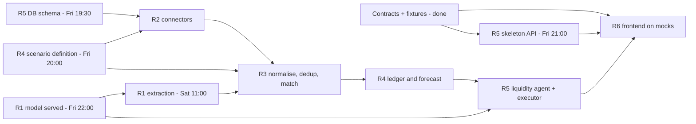

# 04 — Development plan

Self-contained. If you read only this file, you know what to build, with whom, by when, and what to cut.

Product in one line: **Ordo** turns a small company's messy money data into one owner-approved ledger through live connectors and a matching engine, then uses it to warn about a cash gap and prepare the fix (a credit line, approved by the owner, executed in simulation).

---

## 0. The clock

| Fact | Value | Status |
|---|---|---|
| Now | Friday 20 Nov 2026, about 17:00 | — |
| Feedback sessions | Saturday 14:00–18:00 (our slot unknown) | VERIFIED ([schedule](https://www.collabothon.eu/schedule/)); slot UNVERIFIED |
| Coding ends | **Sunday 10:00** | VERIFIED (same) |
| Presentations | Sunday 10:30–15:00 | VERIFIED (same) |
| Time left | about 41 hours on the clock; about 24 working hours per person; **about 145 person-hours in total** | estimate |

The plan below uses 145 person-hours for must-have and should-have work. There is no slack for anything else. The brainstorm idea "plan today, start tomorrow evening" is cancelled: **a model is being deployed tonight**.

Hard criteria first: by **Friday 22:00** a page served from the cluster shows text generated by a model served on the cluster. Everything else comes after.

---

## 1. Repo layout and stack

```
/contracts      schemas, openapi.yaml, events.md, fixtures, validate_fixtures.py   (exists)
/docs           this plan and the other documents                                   (exists)
/spikes         throwaway proofs                                                    (exists)
/backend        one Python package, four entrypoints:
    api/          FastAPI: REST + SSE                         (role 5)
    connectors/   polling workers                             (role 2)
    pipeline/     extract, dedup, match, who-paid             (roles 1 and 3)
    finance/      ledger, forecast, scenarios, tax calendar   (role 4)
    agents/       liquidity, chat, tools, MCP server          (role 5)
    db/           SQL migrations, outbox helpers              (role 5)
/sim            bank simulator, generator, releaser           (roles 2, 3, 4)
/frontend       React + Vite + TypeScript                     (role 6)
/deploy         OpenShift manifests (kustomize), Secrets templates, model serving YAML (role 1)
/notebooks      MLflow evaluation notebook                    (role 1)
```

| Layer | Choice | Why |
|---|---|---|
| Backend | Python 3.12, FastAPI, psycopg, pydantic models generated from `contracts/schemas` | One language for connectors, engine and agents; spikes are already Python |
| DB + queue | PostgreSQL (one pod) | D-07 |
| LLM client | `openai` SDK against the in-cluster vLLM URL | OpenAI-compatible; swap to OGX later by changing the base URL |
| Frontend | React + Vite + TypeScript, a chart library (Recharts or similar), SSE | Challenge card suggests TypeScript web apps |
| Images | One backend image, one frontend image, one sim image; built on the cluster with BuildConfigs from the Git repo | Survival guide approach (`oc new-app <builder>~<git url>`) |

---

## 2. The six roles

Rebalanced from the starting suggestion. Changes and reasons:

| Change | Reason |
|---|---|
| FX agent upgraded from a 3-hour nice-to-have to **FX Shield**, a 5-hour must-have for role 4 (+0.5 h each on role 2's tasks 2.6 and 2.13) | A team member's brief made it precise, and spike 05 proved the method on real NBP data. Role 4 had the only slack (pitch tasks were removed). Cost: role 4's slack is gone, so the tax calendar (4.6) will probably not be built |
| Outbox framework and simulated executor moved from role 5 to role 2 (tasks 2.12, 2.13); chat split into a 3-hour must and a 2-hour should | `tools/status.py forecast` showed role 5 at 27 must-have hours against 22 working hours before the freeze, and role 2 at 15.5. Role 2 already owns the Sandbox Bank the executor talks to |
| Synthetic data, domain rules and pitch moved **out of** the frontend role | Frontend alone is about 25 hours. A person who must also write the generator and the pitch would finish none of them |
| Receipt/PDF **extraction** (the model-facing part) moved to role 1 | The model owner tunes prompts, JSON schema and serving flags together, and evaluates them in MLflow (which is also a bonus item) |
| Role 4 is "finance engine + domain rules + scenario" | The person who owns the forecast also owns the scenario data, so the demo numbers and the engine cannot drift apart |
| No role owns the pitch (team decision, 20 Nov) | Everyone builds the application first. The presentation is prepared by the whole team after the feature freeze, and the speaker is chosen then. The script is already drafted in `05_DEMO_AND_PITCH.md` |
| Dataset split across three roles by artefact | Scenario definition (role 4), document rendering (role 3), release through real sources (role 2). Each needs that data for their own tests anyway |

Ownership check — nothing is orphaned:

| Topic | Owner |
|---|---|
| Hard criteria (deployed app + served model) | Role 1 |
| Bonus items | Role 1 |
| Connectors, Sources page data | Role 2 |
| Data release ("drip") | Role 2 |
| Document test set (templates, printed receipts, photos) | Role 3 |
| Matching rules | Role 3 |
| Domain rules table (tax hints, calendar) | Role 4 |
| Scenario numbers, ground truth | Role 4 |
| Pitch, slides, speaker | Whole team, after the feature freeze (Saturday 22:00). Not assigned now |
| Feedback session (Saturday 14:00–18:00) | Whoever is least blocked at that moment; they read the 1-minute text in `05_DEMO_AND_PITCH.md` section 2 and show the app. No preparation task |
| Questions to organisers | Anyone, on Discord, from `06_RISKS_AND_QUESTIONS.md` section 2 |
| API, DB schema, event queue, integration | Role 5 ("integration captain") |
| Control model, approvals, simulated execution | Role 5 |
| UI/UX, demo polish | Role 6 |
| Demo operation on stage | Role 5 (clicks), role 3 (phone) |
| Contracts | Producer role owns each schema; role 5 arbitrates |

### Role 1 — Platform, model and document reading

| | |
|---|---|
| Skills | OpenShift/Kubernetes, containers, LLM serving, prompt and schema design |
| Inputs | Cluster credentials; `01_SOLUTION.md` sections 6.3 and 7; `contracts/schemas/document.schema.json` |
| Outputs | Running cluster project; served model endpoint; deployed services with routes; `extract_document()`; MLflow traces + evaluation notebook; guardrails route |
| Depends on | Nobody for the first 5 hours |
| Mocks until dependencies land | Deploy a "hello model" page before any real service exists |

| # | Task | Est. | Priority |
|---|---|---|---|
| 1.1 | Recon: `nvidia-smi` (GPU type), `oc get datasciencecluster -o yaml` (what is enabled), `oc adm top nodes`, outbound test from a pod to `huggingface.co`, `imap.gmail.com:993`, `api.nbp.pl`, `api.telegram.org`. Post results in the channel | 1 h | Must |
| 1.2 | Start model download and serving: vLLM runtime, RawDeployment, model by GPU scenario (table in `01_SOLUTION.md` 6.3), tool-calling flags, `Recreate` strategy. Fallback: Mistral modelcar from `registry.redhat.io` | 3 h | Must |
| 1.3 | Project `ordo`, PostgreSQL, PVC for raw files, Secrets, BuildConfigs for the 3 images, routes, resource limits on everything | 5 h | Must |
| 1.4 | `extract_document(bytes, content_type) -> Document fields + confidence`: vision prompt, `response_format` JSON schema, validation checks, Docling call for text PDFs | 6 h | Must |
| 1.5 | MLflow: enable component, `mlflow.openai.autolog()` in pipeline and agents, `trace_id` stored on documents and recommendations | 2 h | Must (bonus) |
| 1.6 | Evaluation notebook in a Jupyter workbench: extraction accuracy on the document test set against ground truth, logged to MLflow | 2 h | Must (bonus) |
| 1.7 | NeMo Guardrails in front of chat: PII masking + topic rail | 3 h | Should (bonus) |
| 1.8 | `make smoke`: script that checks every route, the model, DB, and one end-to-end fixture | 1 h | Must |
| 1.9 | Show each finished bonus item to Georg/Karsten as soon as it works | 0.5 h | Must |
| 1.10 | OGX server + register our MCP server | 4 h | Stretch |

Done when: route URL loads the app from outside; `/api/v1/health` reports the in-cluster model as reachable; 12 real receipt photos extract with the gross amount right on at least 10 and the rest in `needs_review`; MLflow shows traces; `make smoke` is green twice in a row.

### Role 2 — Connectors and sync

| | |
|---|---|
| Skills | Python, HTTP APIs, IMAP, idempotent job design |
| Inputs | `02_DATA_AND_SYNC.md` section 3; `contracts/bank-sim-api.md`; schemas `source`, `sync_run`, `raw_item`; `events.md` |
| Outputs | RawItems + `raw_item.received` events; Sandbox Bank service; releaser; `/sources`, `/sync-runs` data |
| Depends on | Role 5 for the DB tables (Friday 19:30); role 1 for outbound access results |
| Mocks | Until the DB exists, write RawItems as JSON files shaped like `fixtures/raw_item.json` |

| # | Task | Est. | Priority |
|---|---|---|---|
| 2.1 | Create the test mailbox tonight (app password, IMAP on). Create a Telegram bot token as the fallback | 0.5 h | Must |
| 2.2 | Connector base class: SyncRun, cursor, idempotency key, retries, source status | 2 h | Must |
| 2.3 | Mailbox connector (poll 20 s, attachments, forwarded-by) | 4 h | Must |
| 2.4 | Sandbox Bank simulator incl. `load-csv` for the pizzeria file, demo clock, credit-line and payment-draft endpoints | 3 h | Must |
| 2.5 | Bank connector (PSD2-shaped polling, delta by `entryReference`) | 2 h | Must |
| 2.6 | NBP rates connector + `/fx/rates` (port spike 02) + 3 years of daily history for FX Shield | 1.5 h | Must |
| 2.12 | Outbox consumer framework (claim, retry, dead) used by all workers — moved from role 5 | 2 h | Must |
| 2.13 | Simulated executor: credit-line application, payment draft and FX forward against the Sandbox Bank; called by role 5's decision endpoint — moved from role 5 | 2.5 h | Must |
| 2.7 | Releaser: push scenario artefacts through the real sources (bank admin API, SMTP to the mailbox, inFakt API) in `backfill` and `drip` modes | 3 h | Must |
| 2.8 | inFakt sandbox connector (sales invoices, paid status) | 3 h | Should |
| 2.9 | Commerzbank developer sandbox, accounts read-only. **Time-box: 90 minutes.** If no working token by then, stop | 1.5 h | Should |
| 2.10 | Telegram connector (long polling) as second document channel | 2 h | Should (fallback for 2.3) |
| 2.11 | KSeF test API connector | 4–6 h | Cut first |

Done when: forwarding an e-mail with a photo creates exactly one `email` and one `email_attachment` RawItem within 25 s; running any connector twice creates nothing new; the Sources page shows changing "last synced" times; the pizzeria CSV is ingested through the bank connector (1,125 lines).

### Role 3 — Matching and document test set

| | |
|---|---|
| Skills | Python, data wrangling, careful with money and edge cases |
| Inputs | Spike 04 (working prototype); `02_DATA_AND_SYNC.md` section 4; schemas `document`, `transaction`, `counterparty`, `match`, `ledger_entry` |
| Outputs | Normalised transactions; documents de-duplicated; matches with reasons; who-paid consequences; ledger entry proposals; `/documents`, `/matches` endpoints; the document test set |
| Depends on | Role 1 for `extract_document` (use fixtures until Saturday 11:00); role 2 for RawItems |
| Mocks | `fixtures/document.json`, `fixtures/transaction.json`; spike 04's generator for volume |

| # | Task | Est. | Priority |
|---|---|---|---|
| 3.1 | Normaliser: bank JSON -> Transaction (incl. the CHF/reference-text fix, rule DQ-01), FA(3) XML -> Document, inFakt JSON -> Document | 3 h | Must |
| 3.2 | Dedup (rules D1–D3), golden record | 2 h | Must |
| 3.3 | Match scoring + greedy assignment + reasons (port spike 04) | 4 h | Must |
| 3.4 | Who-paid decision table + consequences (VAT, reimbursement) + ledger entry proposals | 3 h | Must |
| 3.5 | Counterparty resolution with alias learning | 2 h | Must |
| 3.6 | Endpoints: `/documents`, `/documents/{id}`, `PATCH`, `/matches`, `/matches/{id}/decision` (with role 5's API skeleton) | 3 h | Must |
| 3.7 | Document test set: 2 HTML templates (invoice, receipt) -> PDF/PNG, about 40 November documents from role 4's scenario, FA(3) XML template; **print 12 SAMPLE receipts and photograph them with phones** | 4 h | Must |
| 3.8 | "Missing document" and "document without payment" detection | 1 h | Should |
| 3.9 | Private-use flag | 1 h | Nice |

Done when: on the scenario data, every purchase in `ground_truth.json` gets the right `paid_by`; the hero receipt produces `fixtures/match.json[0]`-shaped output; no auto-confirmation ever happens for an item with a tax consequence.

### Role 4 — Finance engine, domain rules and scenario

| | |
|---|---|
| Skills | Python, finance/accounting sense |
| Inputs | Spikes 01 and 03; `02_DATA_AND_SYNC.md` sections 2.5 and 5; schemas `ledger_entry`, `forecast`; `05_DEMO_AND_PITCH.md` |
| Outputs | Ledger; forecast with components and alerts; scenarios; tax calendar; scenario definition + `ground_truth.json` |
| Depends on | Role 3 for approved ledger entries (use bank lines + fixtures until then) |
| Mocks | Pizzeria CSV directly; `fixtures/forecast.json` |

| # | Task | Est. | Priority |
|---|---|---|---|
| 4.1 | Scenario definition: `sim/scenario.py` with recurring series (Jan–Nov), November purchases, clients, the liquidity story numbers from `02_DATA_AND_SYNC.md` 2.5; writes `ground_truth.json` | 3 h | Must |
| 4.2 | Forecast engine (port spike 03, fix the tax-series split): fixed series, weekday averages, known receivables with per-client delay, known payables, reimbursements, owner events | 6 h | Must |
| 4.3 | Alerts, credit-line sizing, scenario endpoint (credit line, shift receivable), stress case | 4 h | Must |
| 4.4 | Regression tests: pizzeria 33,266.35 / −22,097.60 on 2025-07-03; scenario low −7,870 on 5 Dec | 1 h | Must |
| 4.5 | Endpoints `/ledger`, `/ledger/summary`, `/forecast/*` (with role 5) | 2 h | Must |
| 4.6a | "VAT lost this year" figure in `/ledger/summary` (the demo script shows it at 1:15) | 0.5 h | Must |
| 4.6 | Tax calendar (VAT 25th, advances 20th, ZUS 15th, weekend shift) + VAT position from the ledger + tax-reserve recommendation data | 2.5 h | Should — first should-have to build |
| 4.9 | **FX Shield** engine (`03_FX_SHIELD.md`): rate-history scenarios, downside (95th percentile, expected shortfall), netting, profit framing, decision rule, product catalog, "hedge" and "not worth it" cards. Port spike 05 | 5 h | **Must** |
| 4.10 | Month-over-month insight sentence | 1 h | Nice |

Done when: both regression tests pass in CI; `/forecast/latest` returns components that each carry at least one evidence link; adding the event "closed 1–30 June" to the pizzeria moves the low to about −21.8k.

### Role 5 — API, agents, approvals (integration captain)

| | |
|---|---|
| Skills | Python backend, LLM tool calling, state machines; decides integration questions |
| Inputs | `contracts/openapi.yaml`, `events.md`, schemas `recommendation`, `approval`, `event`; `01_SOLUTION.md` sections 4 and 6.2 |
| Outputs | DB schema; API skeleton serving fixtures, then real data; outbox + SSE; recommendation/approval state machine; simulated executor; liquidity agent; chat; MCP tool server |
| Depends on | Role 1 for the model URL (Friday night); roles 3 and 4 for real data behind the endpoints |
| Mocks | The API skeleton **is** the mock: every endpoint returns the fixture until its owner replaces it |

| # | Task | Est. | Priority |
|---|---|---|---|
| 5.1 | DB migrations for all entities; outbox tables; pydantic models from schemas | 3 h | Must |
| 5.2 | API skeleton: all 33 paths returning fixtures; SSE stream replaying `fixtures/event.json` | 3 h | Must — **by Friday 21:00** |
| 5.4 | Recommendation + Approval state machine; `/inbox`, `/recommendations/{id}/decision`, `/approvals`, `/activity`; server-side refusal of `permitted` | 4 h | Must |
| 5.6 | Liquidity agent: tool loop over forecast/scenario tools -> schema-constrained Recommendation; number check against tool results; template fallback | 5 h | Must |
| 5.7 | Chat: 5 tools (`get_cash_position`, `get_forecast`, `search_ledger`, `explain_recommendation`, `add_forecast_event`), evidence links in answers, suggested-question buttons | 3 h | Must |
| 5.7b | Chat hardening: free-text multi-turn, refusals, wrong-tool recovery | 2 h | Should |
| 5.8 | Tools exposed as an MCP server (same functions) | 1 h | Should |
| 5.9 | `run_readonly_sql` tool with the guarded role | 2 h | Should |
| 5.10 | Reimbursement and tax-reserve recommendation cards (template text) | 1 h | Must |
| 5.11 | Reminder e-mail draft action | 1 h | Nice |

Done when: approving `rec_cl01` with a changed limit creates an Approval with `execution.mode = simulated`, a reference from the Sandbox Bank and a new forecast; a chat message "we are closed 1–30 June" on the pizzeria creates a forecast event; no generated text contains a number absent from the tool results (unit test with a deliberately wrong model answer).

### Role 6 — Frontend and UX

| | |
|---|---|
| Skills | React/TypeScript, layout, charts, eye for clarity |
| Inputs | `contracts/fixtures/*` (the mock data); `contracts/openapi.yaml`; `05_DEMO_AND_PITCH.md` sections 3 and 4 |
| Outputs | The web app; slide visuals |
| Depends on | Nobody at the start (fixtures); role 5's skeleton API from Friday 21:00 |
| Mocks | Static JSON from `contracts/fixtures`, then the skeleton API |

| # | Task | Est. | Priority |
|---|---|---|---|
| 6.1 | App shell, routing, API client typed from the schemas, mock mode | 2 h | Must |
| 6.2 | Dashboard: cash position, cash weather, forecast chart with red zone and component tooltips | 5 h | Must |
| 6.3 | Inbox: recommendation cards with the four badges, "Why?" panel (reasons, calculation, alternatives, evidence links), approve/edit/reject with SIMULATED wording | 5 h | Must |
| 6.4 | Document view: image/PDF next to fields, low-confidence highlight, edit, who-paid banner | 3 h | Must |
| 6.5 | Sources page: status, last synced, counters, manual sync, live via SSE | 2 h | Must |
| 6.6 | "What I did on my own" activity feed | 1 h | Must |
| 6.7 | Chat panel with evidence chips and optional table | 2 h | Must |
| 6.8 | Company switcher (Borsuk Labs / Pizzeria Amalfi); data-quality notes | 1 h | Must |
| 6.9 | Live toasts and chart animation on `forecast.updated` | 2 h | Must (it is the live moment) |
| 6.10 | Simple/Detailed toggle; large-type check; empty and error states | 2 h | Should |
| 6.12 | Language toggle PL/DE | 2 h | Nice |

Done when: the whole 3-minute script can be clicked through against fixtures (Saturday 13:00) and against the real backend (Saturday 22:00); every card shows control level and execution mode; a person who has not seen the app can say what to do next within 10 seconds of seeing the dashboard.

---

## 3. Hour-by-hour timeline

Milestones are **bold**. "All" = whole team.

### Friday 20 Nov

| Time | R1 Platform + reading | R2 Connectors | R3 Matching | R4 Finance | R5 API + agents | R6 Frontend |
|---|---|---|---|---|---|---|
| 17:00–17:30 | All: read this file, confirm roles, copy `/contracts`, `/docs`, `/spikes` into the fresh event repo, agree channel and branch rules | | | | | |
| 17:30–18:30 | 1.1 recon; post GPU + egress results | 2.1 mailbox + bot; 2.2 base class | Read spike 04; start 3.1 | 4.1 scenario definition | 5.1 migrations | 6.1 shell + mock mode |
| 18:30–20:00 | 1.2 model download + serving | 2.4 bank simulator | 3.1 normaliser | 4.1 scenario; 4.4 pizzeria test first | 5.2 skeleton API on fixtures | 6.2 dashboard on fixtures |
| 20:00–20:30 | All: food + 10-minute stand-up. Decide model by GPU. Unblock | | | | | |
| 20:30–22:00 | 1.3 project, Postgres, builds, routes. **M1 (22:00): "hello model" page served from the cluster, calling the served model — hard criteria met** | 2.5 bank connector; load pizzeria CSV; 2.12 outbox | 3.2 dedup | 4.2 forecast engine on pizzeria | **5.2 done by 21:00**; 5.4 state machine | 6.3 inbox cards |
| 22:00–00:00 | 1.3 deploy skeleton API + frontend + bank sim to the cluster | 2.3 mailbox connector | 3.3 match scoring | 4.2 forecast | 5.4 state machine | 6.3 Why panel; 6.5 sources |
| 00:00 | **M2: walking skeleton on the cluster — frontend + skeleton API + Postgres + bank simulator deployed; one e-mail fetched into a RawItem.** Stand-up, then sleep | | | | | |

### Saturday 21 Nov

| Time | R1 | R2 | R3 | R4 | R5 | R6 |
|---|---|---|---|---|---|---|
| 08:30–09:00 | All: stand-up. Check M1/M2 really hold. Re-plan if the model is not serving | | | | | |
| 09:00–11:00 | 1.4 extraction on real photos | 2.3 finish; 2.6 NBP; 2.13 executor | 3.7 print + photograph receipts; templates | 4.3 alerts + credit sizing | 5.4 finish; 5.10 cards | 6.4 document view |
| 11:00–13:00 | 1.4 + checks; 1.5 MLflow autolog | 2.7 releaser (drip one item end to end) | 3.4 who-paid + ledger proposals (now on real extraction) | 4.5 endpoints; 4.6a VAT-lost figure | 5.6 liquidity agent | 6.9 live toasts; 6.6 feed |
| 13:00 | **M3: hero flow works once on the cluster: forwarded photo -> document -> "paid privately" -> reimbursement card -> forecast moves. Clickable demo of the full script on fixtures where real data is missing.** Record a screen video immediately | | | | | |
| 13:00–14:00 | All: lunch | | | | | |
| 14:00–18:00 | 1.6 eval notebook; 1.9 show vLLM + MLflow + Jupyter to Red Hat | 2.8 inFakt; 2.9 Commerzbank sandbox (90 min box) | 3.5 counterparties; 3.6 endpoints | 4.6 tax calendar. **Feedback session** (slot unknown): whoever is least blocked goes for 30 min with the 1-minute text from `05_DEMO_AND_PITCH.md` | 5.7 chat | 6.2 chart polish; 6.7 chat panel; 6.8 switcher |
| 18:00–18:30 | **All: decision meeting.** Apply feedback using the options table in `05_DEMO_AND_PITCH.md` section 2. Decide stretch items. Update the cut list | | | | | |
| 18:30–20:00 | 1.7 guardrails | 2.7 backfill run of the full scenario | 3.8 missing documents | 4.4 scenario regression; fix numbers | 5.7 chat; 5.8 MCP | 6.10 simple/detailed |
| 20:00 | **M4: liquidity flow complete on real data: forecast, alert, credit card with explanation, approve with edit, simulated execution, chart redraws. Pizzeria company works with the June event** | | | | | |
| 20:00–22:00 | 1.8 smoke script; limits; 1.9 show guardrails | 2.10 Telegram fallback | Fix matching misses found in backfill | 4.9 FX Shield (start earlier if 4.3 is done) | 5.9 SQL tool or bug fixing | Demo polish, empty/error states |
| **22:00** | **FEATURE FREEZE.** Only bug fixes, data fixes and copy changes after this. Nothing new is started. Anything unfinished is cut or mocked | | | | | |
| 22:00–23:30 | All: integration slot. Run the whole script three times on the cluster. Every failure becomes a ticket with one owner | | | | | |
| 23:30–00:30 | **M5: fallback video recorded** (full script, on the cluster). Rehearsal 1 with a timer. Then sleep | | | | | |

### Sunday 22 Nov

| Time | Activity |
|---|---|
| 07:00–07:30 | R1: `make smoke`, restart anything unhealthy, stop workbenches. R2: check mailbox and connectors. R4: reset the demo clock and data to the start state |
| 07:30–08:30 | Fix only what the smoke test or rehearsal 1 found. No refactoring |
| 08:30–09:00 | Rehearsal 2 (full, timed, with the phone) |
| 09:00 | **CODE FREEZE.** Tag `demo`. Fill in and submit the challenge information card template (R4) |
| 09:00–09:45 | Rehearsal 3. Prepare the second "already sent" receipt. Open tabs: app, RHOAI dashboard (served model), MLflow traces |
| 10:00 | Coding ends (official). Nobody touches the cluster except to restart a pod |
| 10:30–15:00 | Presentations. Forward the backup receipt 2 minutes before our slot |

---

## 4. Must-have versus nice-to-have per role

| Role | Must-have (the demo fails without it) | Should | Nice | Cut first |
|---|---|---|---|---|
| 1 | Served model; deployed services; extraction; MLflow traces + eval notebook; smoke script | NeMo Guardrails | OSS coding agent in a workbench | OGX + MCP registration |
| 2 | Mailbox, bank simulator + connector, NBP, outbox framework, simulated executor, releaser | inFakt, Commerzbank sandbox, Telegram | — | KSeF API |
| 3 | Normaliser, dedup, matching, who-paid, endpoints, document test set | Missing-document detection | Private-use flag | — |
| 4 | Scenario, forecast, alerts + credit sizing, regressions, endpoints, VAT-lost figure, FX Shield | Tax calendar + reserve (will probably not fit) | Insights sentence | — |
| 5 | Schema, skeleton API, state machine, liquidity agent, chat with 5 tools | Chat hardening; MCP server; SQL tool | Reminder draft | — |
| 6 | Shell, dashboard, inbox + Why, document view, sources, feed, chat panel, switcher, live toasts | Simple/Detailed toggle | PL/DE toggle | — |

## 5. Cut order when time runs out

Decide at Saturday 18:00 and again at 22:00. Cut from the top.

| # | Cut | Replace with |
|---|---|---|
| 1 | KSeF API connector | FA(3) XML arriving by e-mail (same parser) |
| 2 | OGX | Plain tool loop (already the baseline) |
| 3 | FX Shield extras: netting, option alternative, comparison graphic | The scenario method and the two cards stay (must-have) |
| 4 | Free SQL tool in chat | The 5 fixed tools |
| 5 | Commerzbank sandbox connector | A line on the architecture slide: "connector interface is PSD2-shaped" |
| 6 | NeMo Guardrails | Code-level rule "chat cannot execute" (already there) |
| 7 | inFakt connector | Sales invoices released as FA(3) XML into the mailbox |
| 8 | Tax reserve card | Tax amounts still appear as forecast components |
| 9 | Chat (free text) | Three suggested-question buttons that call the same tools |
| 10 | Borsuk Labs backfill history | November only; the forecast uses recurring series seeded from bank lines |

Never cut: served model on the cluster; the hero receipt flow; forecast + credit card + approval + simulated execution; control-level badges; the pizzeria company.

Emergency demo (if the messy pipeline is not stable by Saturday 22:00): pizzeria-only liquidity agent — CSV through the bank connector, two data-quality notes, chat event "closed in June", forecast, credit card, approval, simulation. It needs roles 1, 2 (bank only), 4, 5, 6 and no document reading. It still meets the hard criteria and the complete workflow.

---

## 6. Git workflow

| Topic | Rule |
|---|---|
| Repo | The fresh GitHub repo created for the event (rule: created no earlier than Friday — VERIFIED, [rules](https://www.collabothon.eu/rules/)). Its URL is what Red Hat received. Commit early and often: organisers read the code during the event |
| Branches | Trunk-based. `main` always deploys. Short branches `r<role>/<topic>`, alive for hours, not days |
| Merging | You merge your own PR if it only touches your folder and CI is green. Cross-folder changes need the other folder's owner (a thumbs-up in chat is enough) |
| CI | One GitHub Action: `python3 contracts/validate_fixtures.py`, backend unit tests (incl. the two regression tests), frontend type-check. Under 3 minutes |
| Deploy | Role 1 owns `deploy/`. Builds on the cluster are triggered by role 1 (or a webhook) from `main`. Before freeze: deploy on demand. After freeze: only role 1 deploys |
| Contracts | A change = one PR touching schema **and** fixture, validator green, announced in chat, approved by the consuming role. After the feature freeze only additive optional fields. Role 5 arbitrates conflicts in 5 minutes, not 50 |
| Secrets | Never in Git. `deploy/secrets.example.yaml` has names only; real values via `oc create secret` |
| Synthetic data | Generated files are reproducible from the seed; commit the scenario code and `ground_truth.json`, not thousands of PDFs |
| Stand-ups | Fri 20:00, Fri 00:00, Sat 08:30, Sat 13:00, Sat 18:00, Sat 22:00, Sun 07:00. Ten minutes: milestone status, blockers, cuts |
| Coding assistants | Allowed (challenge card). Use them on the contracts: "implement this endpoint to match this schema and this fixture" |

---

## 7. Progress tracking across six Claude sessions

Every person works in their own Claude Code session on their own role. Sessions coordinate through the repo:

| Piece | What it does |
|---|---|
| `CLAUDE.md` | Loaded by every Claude Code session automatically. Tells it which folders it owns, the work loop, what to do when a dependency is not finished, and the hard rules |
| `.role` | A local file with your role number (`echo 3 > .role`). Not committed |
| `status/role-N.json` | One file per role with every task, its status, what it needs, and the stand-in to use meanwhile. Only role N writes it, so there are no merge conflicts |
| `tools/status.py` | `board` (whole team), `next` (what I can start), `set <ID> <status> --push`, `wait <ID>` (blocks until another role's task is done; run in the background), `forecast` (can each role still finish before the freeze), `ask <role> "..."` (request to another role) |

Task states: `todo` -> `in_progress` -> `mock_done` (works against the stand-in, waiting for the real dependency) -> `done` (works against the real thing). `cut` = dropped, with a note.

Set-up per person (2 minutes): clone the repo, `echo <role number> > .role`, start Claude Code in the repo folder, and say "start my role".

Reading as of Friday 16:03 (`forecast`): 22 working hours per person until the freeze. Roles 1–5 are TIGHT (18.5–21.5 must-have hours). **Role 6 is OVER by about 1 hour** (23 hours): whoever is waiting on a dependency helps the frontend first, and 6.10 and 6.12 are not started.

## 8. Dependencies at a glance



Nobody is blocked in the first four hours: everyone starts from contracts, fixtures or a spike.
